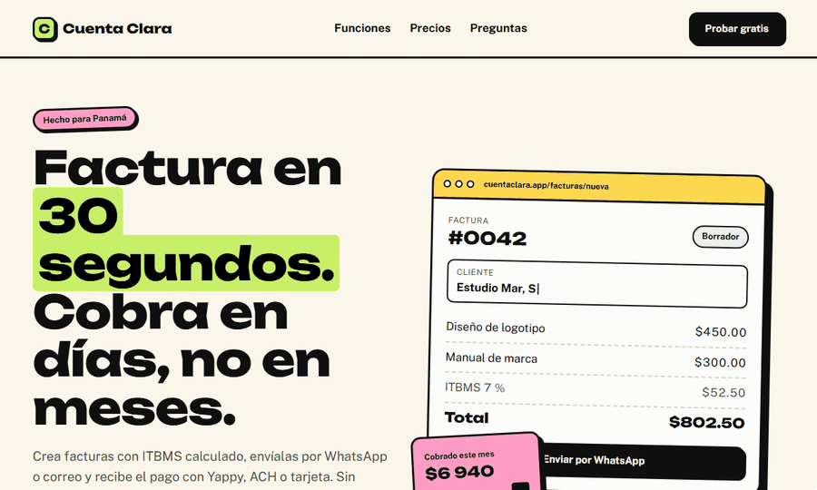

# Cuenta Clara · landing de un SaaS de facturación

Landing page para **Cuenta Clara**, un producto ficticio de facturación para freelancers y pymes de Panamá. Proyecto de diseño web en estilo **neo-brutalista**: bordes gruesos, sombras duras, colores planos y tipografía pesada, sin frameworks.

**[Ver el sitio en vivo →](https://fp-507.github.io/cuenta-clara/)**



*La maqueta animada del hero, la calculadora de ITBMS y el cambio de precios mensual/anual.*

## Dirección de arte

- **Estilo neo-brutalista**: bordes negros de 3 px, sombras desplazadas sin desenfoque, botones que "se hunden" al presionarlos y elementos levemente rotados como pegatinas.
- **Paleta**: crema de fondo con lima, rosa, amarillo y azul planos como acentos funcionales: cada color identifica un tipo de bloque.
- **Tipografía**: *Unbounded* para titulares y *Public Sans* para el texto.
- **Contexto local**: ITBMS del 7 %, cobros con Yappy y ACH, y facturación por WhatsApp.

## Interacciones

- **Maqueta animada del producto** hecha en HTML y CSS (no es una imagen): se escribe el nombre del cliente, la factura se envía y aparece la notificación de pago.
- **Calculadora de ITBMS**: subtotal, impuesto y total en vivo, con opción de servicio exento.
- **Calculadora de horas ahorradas** según facturas al mes, minutos por factura y tarifa por hora.
- **Precios mensuales o anuales** con interruptor accesible (`role="radio"` y flechas del teclado).
- **Preguntas frecuentes** con `<details>` nativo y una cinta de texto en movimiento.

## Calidad

- Responsive de 320 px en adelante, sin desborde horizontal (la cinta inclinada se recorta con `overflow-x: clip`).
- Foco visible, contraste alto y respeto de `prefers-reduced-motion`: sin animaciones, la maqueta muestra directamente el estado final.

## Estructura

```
index.html   contenido y secciones
estilo.css   sistema visual neo-brutalista
app.js       maqueta animada, calculadoras y precios
```

> Producto, precios, cifras y testimonios ficticios, creados para este proyecto de portafolio.

## Para retomar el proyecto

Arquitectura, decisiones técnicas, cómo extenderlo y pendientes: [DESARROLLO.md](DESARROLLO.md).
